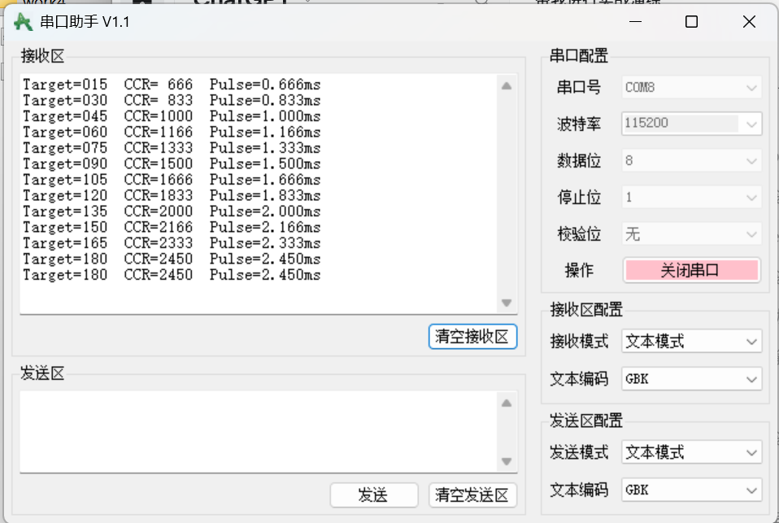

# 电控组第四次培训作业

姓名：王国阳  
学号：20253008726

作业标识：RM-2027-电控培训-作业-王国阳  
GitHub 仓库名：stm32work4

## 功能

使用 STM32F103C8T6 的 TIM2_CH1 输出 50Hz PWM，控制 180°位置型 SG90 舵机。

- 上电按 0° → 45° → 90° → 135° → 180° 的顺序演示一遍，每个目标保持 1 秒，之后持续保持最后一个位置。
- OLED 显示 Target、CCR、Pulse，串口输出同一组数值。
- PB12 每次增加 15°，PB14 每次减少 15°，软件目标限制在 0°～180°。
- 两个按键均为下拉输入，按下接通 3.3V，采用 20ms 非阻塞消抖，长按只触发一次。
- 第一次有效按键停止自动演示，之后进入手动控制；复位后重新演示。
- 主循环使用 HAL_GetTick() 计时，等待下一次角度切换时仍处理按键和 OLED。

Target 是软件目标，当前程序没有从舵机读取实际角度。CCR 是本次写入比较寄存器的值，开启通道预装载时会在 PWM 更新边界生效。

## 接线

| 功能 | 接线 |
|---|---|
| 舵机信号 | PA0，TIM2_CH1 |
| 舵机 VCC | 独立 5V 电源，供电能力至少 1A |
| 舵机 GND | 独立电源 GND，同时连接开发板 GND |
| OLED SCL / SDA | PB8 / PB9，软件 I2C，开漏输出 |
| OLED VCC / GND | 开发板 3.3V / GND |
| USART1 TX | PA9，连接 CH340 RXD |
| USART1 RX | PA10，连接 CH340 TXD |
| CH340 GND | 开发板 GND |
| 加 15°按键 | PB12，按下接通 3.3V |
| 减 15°按键 | PB14，按下接通 3.3V |
| SWDIO / SWCLK | PA13 / PA14 |

I2C 总线需要上拉到 3.3V，使用带上拉电阻的 OLED 模块。所有模块共地，舵机使用独立电源。

按键沿用实际已经连接的 PB12/PB14、高电平按下方式，与培训资料中的 PA1/PA2、低电平按下参考接法不同；功能相同。

## 时钟和定时器参数推导

外部 8MHz HSE 经 PLL 倍频 9 倍得到 72MHz。AHB 不分频，APB1 二分频得到 36MHz。因为 APB1 分频系数不是 1，TIM2 时钟为 PCLK1 的两倍，即 72MHz。

```text
计数频率 = 72000000 / (PSC + 1)
         = 72000000 / (71 + 1)
         = 1000000Hz

计数时长 = 1us

PWM周期 = (ARR + 1) * 1us
        = (19999 + 1) * 1us
        = 20000us = 20ms

PWM频率 = 1 / 0.02s = 50Hz
```

TIM2 使用向上计数、PWM mode 1、高电平有效，初始化 Pulse 为 1500。调节角度时只修改 CCR，保持 PSC=71 和 ARR=19999。

## 角度换算与端点限幅

名义换算使用：

```text
pulse_us = 500 + angle * 2000 / 180
CCR = pulse_us
```

先把目标角度限制在 0°～180°，再把输出脉宽限制在 550～2450us，避免直接使用名义端点的 500/2500us。此实现采用整数运算，不能整除时舍去小数部分。

资料中“留 2°余量对应约 550us”的计算并不一致：2°代入名义公式约为 522us，550us 对应名义角度约 4.5°。本实现直接对输出脉宽限幅，目标显示仍保留 0°和 180°。如果端点出现持续异响或抖动，应缩小脉宽范围后重新验证。

| 软件目标 | CCR | 输出脉宽 |
|---:|---:|---:|
| 0° | 550 | 0.550ms |
| 45° | 1000 | 1.000ms |
| 90° | 1500 | 1.500ms |
| 135° | 2000 | 2.000ms |
| 180° | 2450 | 2.450ms |

具体实现见 [servo.c](work4/Core/Src/servo.c)，可调常量见 [app_config.h](work4/Core/Inc/app_config.h)。

## OLED 与串口

OLED 采用三行显示：

```text
Target:090deg
CCR   :1500
Pulse :1.500ms
```

显示目标变化时更新缓存，OLED_Task() 在主循环中每次最多发送一个变化字符，避免反复清屏。驱动检查应答，通信失败后间隔 1 秒重试。

USART1 参数为 115200、8 数据位、无校验、1 停止位。串口助手选择文本接收，输出格式为：

```text
Target=090  CCR=1500  Pulse=1.500ms
```

每条以 CRLF 结束。角度序列更新或有效按键操作后发送一次。使用 snprintf() 生成文本并通过 HAL_UART_Transmit() 发送，发送和显示均在主循环中完成。

## 串口截图



串口参数为 COM8、115200、8N1。图中目标按 15°步进增加，Target、CCR 与 Pulse 同步变化；达到 180°后继续按加角度键，仍保持 Target=180、CCR=2450、Pulse=2.450ms，体现上限约束。

## 参考资料与驱动来源

1. 第四次培训资料第 9 课《综合作业：用 PWM 让 SG90 转到指定角度》：功能、输出格式、参数计算和提交要求。
2. STMicroelectronics STM32Cube FW_F1 V1.8.7 HAL 驱动及 STM32CubeMX 6.15 生成代码：GPIO、TIM2、USART1 和系统时钟初始化。
3. STMicroelectronics STM32F1 参考手册 RM0008：APB 定时器时钟、PWM 和比较寄存器。
4. 培训提供的 OLED.c、OLED.h、OLED_Font.h：字库和初始化参数。复用第三次作业已适配的 PB8/PB9 软件 I2C 驱动，保留应答检查、失败重试和分步刷新。
